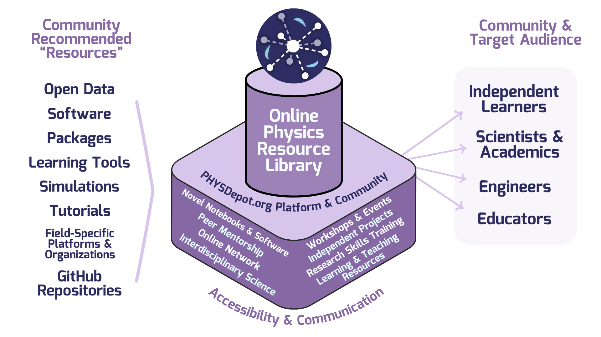

# PHYSDepot.org
Hello! It seems you've landed on the source code for PHYSDepot.org! 
Our platform hosts an online library of open-source, accessible physics/math/STEM resources for the independent learner/researcher. All high-quality resources, simulations, open-source data sets, packages, learning tools, and more organized and curated by scientists with explanations for easy use/onboarding/learning/set-up. Learn to do your own physics research. 

To learn more, including information on how to contribute or join our community of physics researchers, visit us at PHYSDepot.org!

